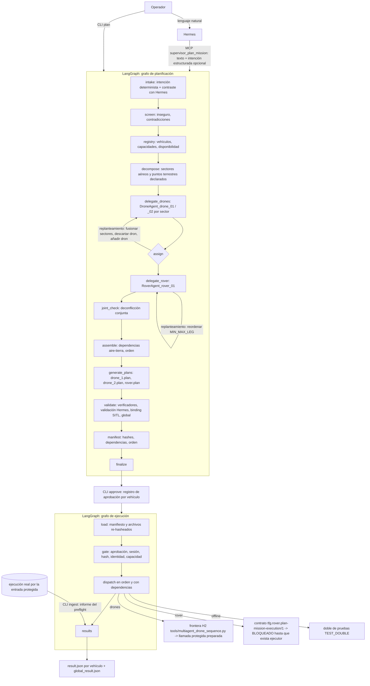

# Supervisor multiagente (Hermes + LangGraph): dos ArduCopter y un ArduRover

Guía de uso con Hermes, proveedores, registro MCP y compatibilidad con el controlador del rover: [hermes-supervisor-providers.md](hermes-supervisor-providers.md).

Estado a 24/11/2026, rama `integration/multiagent-supervisor` (worktree `Agentic_Drone_Mission_Control_supervisor`,
base `693d93846` = `dev/simulation-recovery-week1@0c0c54a30` + integración v3). Todo lo descrito aquí es **software
probado offline**. No se ha ejecutado ninguna misión nueva en SITL con este supervisor.

## 1. Qué hace

Un único supervisor recibe una misión en lenguaje natural, la interpreta, consulta el registro de vehículos, divide
el trabajo, delega en agentes especializados, genera un `.plan` por vehículo, valida individual y globalmente,
escribe un manifiesto con hashes, exige una aprobación humana por vehículo, pasa una puerta de ejecución y entrega
cada plan a los **ejecutores existentes** mediante adaptadores. Los resultados por vehículo y el global siguen los
contratos de SafeFlight Desktop.



## 2. Comandos

```bash
python -m multiagent.supervisor registry --scenario multiagent/fixtures/supervisor/agri_parcel_3v.scenario.json
python -m multiagent.supervisor plan --scenario multiagent/fixtures/supervisor/agri_parcel_3v.scenario.json --out <dir> --text "Inspecciona una parcela agrícola con dos drones y un rover. Divide la zona en dos sectores aéreos. El rover debe visitar tres puntos terrestres. Todos deben regresar a sus posiciones iniciales."
python -m multiagent.supervisor approve --mission <dir>/<mission_id> --vehicle drone_01 --operator <id> --session <sid> --statement "<texto>"
python -m multiagent.supervisor execute --mission <dir>/<mission_id> --session <sid> --executor test-double
python -m multiagent.supervisor execute --mission <dir>/<mission_id> --session <sid> --executor real
python -m multiagent.supervisor ingest --mission <dir>/<mission_id> --vehicle drone_01 --report <report.json>
python -m multiagent.supervisor status --mission <dir>/<mission_id>
```

- `--hermes-intent intent.json` en `plan`: la intención estructurada que produjo el modelo.
- `execute --executor real` **no mueve nada**. Prepara la llamada protegida de los drones (`READY_TO_REQUEST_EXECUTION`) y deja el rover `BLOCKED`.
- `--mode OPERATIONAL` solo acepta aprobaciones `OPERATOR_CLI`. Las de prueba (`TEST_FIXTURE`) y el doble de pruebas se rechazan en ese modo.
- `--receipt-key <archivo>`: recibo HMAC. Solo se emite para resultados `REAL_SITL`. La clave nunca debe estar dentro del repositorio.

**Hermes (MCP).** Servidor `python -m multiagent.supervisor.mcp_server` (stdio). Variables: `TFG_SUPERVISOR_OUT`, un directorio privado fuera del repositorio con `chmod 700`, y `TFG_SUPERVISOR_SCENARIO`, que es opcional.

Expone solo `supervisor_registry`, `supervisor_plan_mission`, `supervisor_get_manifest` y `supervisor_mission_status`. **No hay herramienta de aprobación ni de ejecución**: un modelo no puede aprobar ni ejecutar.

`mcp_server.hermes_profile_entry(python, out)` devuelve la entrada `mcp_servers` del perfil de Hermes, con `tools.include` limitado a esas tres herramientas.

## 3. Módulos

**Creados**

| Módulo | Función |
| --- | --- |
| `multiagent/supervisor/graph.py` | `Supervisor`. Dos `StateGraph` de LangGraph (planificación y ejecución), bucles de replanteamiento, trazas y dry-run de Opik |
| `multiagent/supervisor/scenario.py` | Escenario declarado (`supervisor-scenario/1`) e intención (`supervisor-intent/1`). El texto manda: si la intención de Hermes discrepa de un hecho del texto, se pide aclaración; lo que el texto no dice queda `MODEL_INFERRED` y se muestra en la aprobación |
| `multiagent/supervisor/registry.py` | Registro de vehículos (`vehicle-registry/1`): clase, acciones prohibidas, restricciones, disponibilidad declarada, ejecutor. Las capacidades `DEMONSTRATED_SITL` se re-verifican por hash de su evidencia |
| `multiagent/supervisor/agents.py` | `DroneAgent` por dron (sobre `drone_agent.plan_aerial`), `RoverAgent`, sectores, comprobación aérea conjunta |
| `multiagent/supervisor/rover_route.py` | Ruta terrestre multipunto. Valida cada tramo con la regla de `planning.site_validation`, más velocidad, longitud de tramo, longitud total y energía |
| `inputs/qgc_rover_plan_export.py` | Perfil `QGC_PLAN_ARDUROVER_V1`: `firmwareType=3`, `vehicleType=10`, sin TAKEOFF/LAND, altitud 0, retorno explícito. Incluye verificador independiente |
| `multiagent/supervisor/plans.py` | Escritura única y solo lectura, manifiesto `mission-manifest/1` y re-hash en disco |
| `multiagent/supervisor/validation.py` | Validación global: cobertura, duplicados, separación entre drones, conflicto aire-tierra (se resuelve ordenando), dependencias acíclicas, cabeceras `.plan` |
| `multiagent/supervisor/approval.py` | `plan-approval/1`: ligada a misión, manifiesto, vehículo, tarea, `.plan`, misión ejecutable, sesión y ventana |
| `multiagent/supervisor/executors.py` | Doble de pruebas, adaptador H2 (drones), adaptador `.plan` del rover con contrato `tfg.rover.plan-mission-execution/1`, lector de informes reales |
| `multiagent/supervisor/results.py` | `safeflight.sitl-result` v1 por vehículo, recibo HMAC (solo SITL real), `vehicle-result/1`, `global-result/1` |
| `multiagent/supervisor/__main__.py`, `mcp_server.py` | CLI única y fachada MCP para Hermes |

**Reutilizados sin modificarlos**

| Módulo | Uso |
| --- | --- |
| `multiagent.interpreters` (`RulesInterpreter`, `unsafe_phrases`) | Hechos declarados y frases inseguras |
| `multiagent.drone_agent.plan_aerial`, `multiagent.swarm`, `multiagent.deconfliction` | Rutas, batería, viento, altitud, deconflicción |
| `multiagent.integrated_mission.pinned_allocator` | Asignación fijada por sector |
| `multiagent.orchestrator._swarm_summary` | Resumen de la deconflicción |
| `inputs.qgc_plan_export` (`build_plan`, `verify_plan`) | `.plan` ArduCopter y su verificador |
| `multiagent.hermes_mission_adapter.adapt_proposal` | Reconstrucción byte a byte, `validate_mission` de Hermes, binding SITL |
| `multiagent.drone_execution_bridge` → `tools/multiagent_drone_sequence.py` | Frontera H2 sin efectos, en otro proceso |
| `multiagent.rover_executor_bridge.execution_request` | Petición del rover de un solo objetivo |
| `planning.site_validation`, `planning.site_geometry` | Reglas de terreno y conversión local→WGS84 |
| `multiagent.tracing` (`Tracer`, `opik_dry_run`) | Traza local JSONL y payload de Opik **sin envío** |

`multiagent/orchestrator.py` sigue siendo el planificador de un objetivo por vehículo de los prototipos sellados. El supervisor reutiliza sus agentes y su resumen, no su grafo, para no alterar resultados sellados.

## 4. Estados

- **Planificación:** `PLANNED`, `NEEDS_CLARIFICATION`, `REFUSED_UNSAFE`, `INFEASIBLE` o `BLOCKED`. Todos llevan motivos.
- **Por vehículo:** `NOT_EXECUTED`, `BLOCKED`, `CANCELLED_DEPENDENCY`, `READY_TO_REQUEST_EXECUTION`, `COMPLETED`, `FAILED`, `ABORTED` o `TIMEOUT`. El `data_kind` es `TEST_DOUBLE`, `REAL_SITL` o `NONE`.
- **Global**, en `results/global_result.json`:
  - `PLANNED_PENDING_APPROVAL`, `APPROVED_NOT_EXECUTED` y `READY_TO_REQUEST_EXECUTION`: todavía no se ha ejecutado nada.
  - `EXECUTION_BLOCKED`: algún vehículo obligatorio está bloqueado.
  - `PARTIAL`, `PARTIAL_IN_PROGRESS_OR_BLOCKED` y `FAILED`: ejecución incompleta.
  - `COMPLETED_TEST_DOUBLE`: el doble de pruebas lo completó todo; no es una ejecución real.
  - `COMPLETED`: **solo** cuando todos los vehículos obligatorios están `COMPLETED` en `REAL_SITL` y ningún criterio ha fallado.
- **`result.json` de SafeFlight:** solo se escribe si el vehículo se ejecutó. Un plan solo validado o aprobado no lo tiene.

## 5. Ejecutores: qué existe de verdad

| Vehículo | Capacidad | Estado | Qué hace el adaptador |
| --- | --- | --- | --- |
| ArduCopter | `EXECUTE_GUIDED_WAYPOINT_MISSION_SITL` | `DEMONSTRATED_SITL` (H2, 24/10/2026; evidencia verificada por hash) | Prepara `tools.preflight_sequences.start_preflight_sequence` con dos drones en secuencia, o `tools.virtual_preflight.run_virtual_preflight` con uno. Usa la propia admisión H2. **No la envía** |
| ArduCopter | `EXECUTE_PLAN_AUTO_MISSION_SITL` | `NOT_IMPLEMENTED` | El ejecutor vuela en GUIDED la `MissionDefinition` ligada al `.plan` por `mission_sha256`. El `.plan` no se sube |
| ArduRover | `EXECUTE_GUIDED_SINGLE_GOAL_SITL` | `PENDING_CONTROLLER` | Si la ruta tiene un solo objetivo y no vuelve al inicio, se genera también la petición `rover-execution-request/1` |
| ArduRover | `EXECUTE_PLAN_MISSION_SITL` | `NOT_IMPLEMENTED` | Petición en el contrato del controlador `tfg.rover.plan-mission-execution/1` (`rover_contract.build_request`), con su comprobación de admisión offline (`check_request`). Queda `BLOCKED` con `EXECUTOR_NOT_AVAILABLE`. Compatibilidad detallada en [hermes-supervisor-providers.md](hermes-supervisor-providers.md) §7 |

**Para conectar el controlador del rover sin rehacer el supervisor** hacen falta dos cambios:

1. Implementar el ejecutor que acepte `tfg.rover.plan-mission-execution/1`. Debe:
   - recalcular el hash del `.plan` antes de parsearlo;
   - subir la misión por el protocolo de misión MAVLink y leerla de vuelta;
   - ejecutarla en AUTO y registrar los waypoints alcanzados;
   - terminar en HOLD y desarmar;
   - escribir `result.json`;
   - devolver `vehicle-observation/1` con `REAL_SITL`.
2. Añadir la evidencia sellada en `capability_evidence.json` y pasar la capacidad a `DEMONSTRATED_SITL` con sus hashes.

La puerta la aceptará entonces sin más cambios, y `RoverPlanAdapter.prepare` es el único punto que hay que conectar. El ensayo GUIDED de un metro solo acredita `EXECUTE_GUIDED_SINGLE_GOAL_SITL`. **No acredita** la misión `.plan`.

## 6. Garantías de seguridad comprobadas por pruebas

El supervisor no importa control de vehículos, ROS ni cerrojos (hay prueba por AST). Nunca emite ARM ni movimiento.

La puerta de ejecución rechaza:

- la falta de aprobación;
- una aprobación manipulada, de otro vehículo o de otro plan;
- un `.plan` o un manifiesto modificados después de aprobar;
- una sesión distinta o caducada;
- una aprobación de prueba o el doble de pruebas en modo `OPERATIONAL`;
- una capacidad no demostrada para el ejecutor real.

Además:

- Un plan no validado no se puede aprobar.
- Los archivos `.plan` se escriben una sola vez y quedan en solo lectura.
- Un vehículo dependiente no se ejecuta si su predecesor falló (`CANCELLED_DEPENDENCY`).
- No se repite un vehículo ya ejecutado.
- No hay recibo HMAC para resultados sintéticos.
- `ingest` solo acepta un informe real de un vehículo cuya petición se preparó tras pasar la puerta, y solo si el informe corresponde a los bytes aprobados de su misión (`mission_sha256`). El informe real de H2 del 24/10 se rechaza para las misiones nuevas, porque es de otra misión.
- La intención de Hermes no puede contradecir un hecho del texto.

## 7. Pruebas

- `tests/test_supervisor_integration.py` cubre:
  - los escenarios A (un dron), B (rover: ruta y objetivo único) y C (tres vehículos);
  - D (dron no disponible, batería, viento, rover sin energía, rover no disponible, parámetros ausentes, puntos no declarados, petición insegura, tramo largo con reordenación);
  - E (parcial y cancelación por dependencia);
  - F (seguridad);
  - la intención de Hermes, la evidencia real de H2, las reglas de estado global, la CLI, MCP, el registro y el aislamiento.
- `tests/test_supervisor_desktop_compat.py` ejecuta **el importador y el lector de resultados de SafeFlight Desktop** (extraídos con `git show` de `bdaec12`, sin modificar ese repositorio) sobre los planes y resultados generados. Comprueba:
  - que los planes se importan como `PENDING` sin errores y con el vehículo correcto;
  - que los resultados del doble de pruebas salen como `SYNTHETIC_PASS` o `SYNTHETIC_FAIL`;
  - que un resultado SITL real GUIDED con recibo válido queda `UNVERIFIED`, porque el plan está transformado y no hay lectura de vuelta.

  También incluye las pruebas del exportador ArduRover.

Ejemplos reales generados por la CLI: `multiagent/fixtures/supervisor/examples/agri_parcel_3v/`. Son **SINTÉTICOS**, porque el escenario es sintético.

## 8. Qué falta para considerar completo el sistema multiagente

1. **Primera ejecución SITL del supervisor (drones).** El operador debe ejecutar desde la copia principal, no desde un worktree, la llamada H2 preparada para dos drones, con autorización independiente y J4 cerrado. Después debe ingerir los informes con `ingest`. Hasta entonces, la ejecución por el supervisor está **sin probar en SITL**.
2. **Ejecutor de misión `.plan` ArduRover** (§5). Hoy el rover queda bloqueado siempre. Tampoco hay ningún movimiento GUIDED del rover acreditado en el registro.
3. **Lectura de vuelta en los drones.** SafeFlight solo dará `VALIDATED` con un ejecutor que suba el `.plan` y lo lea de vuelta. Con el ejecutor GUIDED actual el resultado queda `UNVERIFIED`, que es el comportamiento correcto.
4. **Sitio real.** El escenario y el sitio son `SYNTHETIC`. Hay que georreferenciar y medir la parcela, la zona transitable y los perfiles de batería.
5. **Hermes conectado: HECHO el 24/11/2026.** El perfil `tfg-supervisor` hace sesiones reales Hermes → MCP → LangGraph con el modelo local. Ver [hermes-supervisor-providers.md](hermes-supervisor-providers.md). Faltan los proveedores remotos.
6. **Envío a Opik.** Solo hay dry-run. El envío necesita autorización explícita y está fuera de alcance.
7. **Aprobación autenticada.** `OPERATOR_CLI` no está autenticada. La autorización efectiva sigue estando en la entrada protegida.
