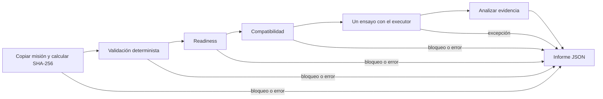

# Primer incremento de virtual preflight con LangGraph

`run_virtual_preflight(mission_path)` ofrece un ensayo explícito de una misión
JSON en Gazebo/ArduPilot SITL. **Arma, despega y mueve exclusivamente el vehículo
simulado `v1`**, y utiliza el aterrizaje y la recuperación del executor existente.
Hermes sólo debe elegir esta herramienta cuando el usuario solicite el ensayo.
No es una comprobación de sólo lectura. Nunca arranca ni reinicia la simulación.

## Workflow y reutilización

El grafo nuevo es independiente de `graph/waypoint_mission_graph.py`:



La validación reutiliza `tools/hermes_mission_validation.validate_mission_file`:
llama al workflow existente, cuya secuencia real es evaluación de seguridad,
replanner si resulta `NOT FEASIBLE`, e informe. No realiza vuelos ni aplica
las recomendaciones del replanner. El preflight conserva esas recomendaciones
como `replan_proposals`; no inventa propuestas de replanning para fallos de
telemetría que el replanner actual no analiza.

El nuevo grafo llama al checker existente de readiness y al helper de
compatibilidad del executor. Además comprueba `route.home`, que necesita el mapper
pero que el helper actual deja para la fase de mapping. Se mantienen las
restricciones reales: multirrotor, ArduPilot o autopilot `unknown` aceptado por el
executor, ruta de waypoints, acciones `navigate` y primera altitud positiva.

Sólo después llama a `execute_approved_mission(snapshot_path, vehicle="v1",
progress=False)`. El executor vuelve a pasar su gate interno y comprueba
compatibilidad. Su gate sigue dependiendo únicamente de validación y readiness:
**este incremento no convierte el preflight en requisito para ejecutar**.
No cambia el flujo JSON, la planificación conversacional ni la exportación QGC.

## Criterios de aceptación v1

`PASSED` exige simultáneamente:

1. Resultado `COMPLETED`, `success=true`, fase `MISSION_EXECUTION`, mismo
   `mission_id` y vehículo `v1`, sin señales de error o recuperación.
2. Contador exacto de waypoints y la misma opción de regreso que la misión.
   Deben existir todos los `WAYPOINT_COMMAND` y `WAYPOINT_REACHED`, en orden,
   con los IDs esperados; el contador por sí solo no demuestra cumplimiento.
3. Secuencia completa del executor: `GUIDED_MODE`, `ARM`, `TAKEOFF_COMMAND`,
   `TAKEOFF_REACHED`, pares de eventos por waypoint, regreso si corresponde,
   `LAND_COMMAND`, `LANDED`. Los comandos deben declarar `success=true`.
   Eventos omitidos, adicionales, duplicados o fuera de orden impiden `PASSED`.
4. Despegue confirmado mediante `reached=true`, altitud objetivo de la primera
   waypoint y error de altura entre 0 y **0,75 m**. El wait del executor sólo
   devuelve este evento cuando observa armado y volando dentro de esa tolerancia;
   el evento no incluye una serie temporal completa de esos estados.
5. Todos los waypoints con `reached=true`, error horizontal entre 0 y **1 m**,
   error de altura entre 0 y **0,75 m** y posición final numérica finita.
   Son las constantes actuales `HORIZONTAL_TOLERANCE_M` y `ALTITUDE_TOLERANCE_M`,
   importadas del executor, no nuevos límites de vuelo.
6. Si se pide regreso, un `RETURN_HOME_REACHED` para `SIMULATION_HOME`, con las
   mismas tolerancias. Es navegación hasta el lanzamiento real seguida de
   aterrizaje, **no activación del modo RTL**.
7. `LANDED` con `landed=true`, `armed=false` y `flying=false`, y posición final
   coherente con el resultado. El wait del executor confirma aterrizaje mediante
   esos estados, no mediante sensor de contacto ni un umbral de altura adicional.
8. Los errores declarados deben concordar con las posiciones retornadas, la
   posición real de lanzamiento y el mapper usado por el executor (margen numérico
   de comparación de 10⁻⁶ m). También se comprueba esa coherencia en el despegue.
   La copia de misión debe conservar su SHA-256 al comprobarla antes y después.

Los waits actuales tienen timeout de 180 segundos para despegue, cada waypoint,
regreso y aterrizaje, y polling de 2 segundos. El análisis usa sus resultados;
no añade una nueva política de timeout ni repite un vuelo. Un aterrizaje de
recuperación, aunque sea correcto, no demuestra que la misión haya terminado.

## Estados e informe persistente

| Estado | Significado |
| --- | --- |
| `PASSED` | El ensayo produjo toda la evidencia exigida por los criterios anteriores. |
| `FAILED` | El executor devolvió fallo o evidencia parcial, contradictoria, malformada o insuficiente. Una recuperación correcta sigue siendo fallo. |
| `BLOCKED` | No se autorizó iniciar el ensayo: misión inválida/insegura, simulación no lista o incompatibilidad. También puede bloquearlo el gate interno al volver a comprobar las condiciones. |
| `ERROR` | Error de lectura, infraestructura, excepción no gestionada por el executor, alteración detectada de la copia o fallo al guardar el informe. No equivale a un vuelo fallido conocido. |

Se crea un directorio independiente por llamada:

```text
missions/generated/preflights/<run_id>/mission.json
missions/generated/preflights/<run_id>/report.json
```

La misión de entrada se lee una vez como bytes, se copia sin reescribir su JSON
y se calcula SHA-256 de esos mismos bytes. Validación, gate y executor reciben
la ruta de la copia. El informe incluye identidad de misión, hash, rutas de
origen/copia/informe, tiempos UTC de inicio/fin, tiempos del executor, transiciones,
validación y propuestas, readiness, incompatibilidades, resultado bruto del
executor, checks del análisis, motivos y estado. Para valores normales JSON se
conserva el resultado del executor sin modificaciones. Si un resultado malformado
contiene un número no finito, se conserva mediante un objeto etiquetado
`{"non_finite_float": "nan"}` (o `inf`/`-inf`) para que el informe siga siendo JSON
estándar; ese resultado no pasa la aceptación.

Antes de llamar al executor se guarda un informe provisional `RUNNING`, con
`execution_attempted=true`; el informe final se sustituye de forma atómica.
Una interrupción del proceso puede dejar `RUNNING`: **no es un resultado de
aceptación** y no activa reanudación ni repetición automática. Si el proceso no
puede guardar el informe devuelve `ERROR` y `report_persisted=false`; no afirma
que exista un informe final persistente. Si falla la persistencia previa al
executor, no lo invoca. Si el executor lanza una excepción sin devolver resultado,
se conserva la excepción y no se inventan eventos ni recuperación.

## Asociación por hash y límites

El hash identifica los bytes concretos de la copia ensayada, no sólo su ID:
un cambio incluso de formato genera otro hash. Editar el archivo original después
de la copia no cambia el ensayo. Las comprobaciones previas/posteriores detectan
algunas alteraciones de la copia, pero no eliminan TOCTOU: el executor vuelve a
abrir rutas, otro proceso con acceso puede modificar y restaurar el archivo entre
comprobaciones, y el entorno/telemetría pueden cambiar durante la ejecución.
No hay firma, atestación del simulador, bloqueo de archivos ni asociación de
consentimiento con el hash. Tampoco hay exclusión mutua entre dos ensayos sobre
`v1`; el operador debe esperar al resultado de uno antes de solicitar otro.

`PASSED` no autoriza hardware real ni concede consentimiento para una ejecución
posterior. El gate actual no consume estos informes. La evidencia proviene de
las observaciones resumidas del executor, no de una grabación independiente de
telemetría ni de una prueba formal de seguridad. El stack de readiness actual
comprueba ambos drones, aunque el ensayo sólo utiliza `v1`.

No se verifican seguimiento de velocidad, acciones agrícolas, survey/inspect/
take_photo, coordinación de varios vehículos ni comportamiento en hardware.
La geometría se traslada al lanzamiento real obtenido de `geopose/filtered`,
no a `gps_global_origin`; el origen se conserva como contexto del executor.
El viento y batería del modelo alimentan la validación, pero este ensayo no
certifica que Gazebo reproduzca esos parámetros. Un `.plan` exportado sigue siendo
una salida independiente; no se afirma que ArduPilot lo cargue para este ensayo.

## Uso desde Hermes

Reiniciar la conexión MCP para descubrir `run_virtual_preflight`. El servidor
sigue arrancándose desde la raíz del repositorio con:

```bash
.venv/bin/python -m tools.hermes_mcp_server
```

La simulación debe estar preparada por el operador mediante el procedimiento
existente. Si no está lista, la herramienta devuelve `BLOCKED` sin iniciarla.
Después de planificar/finalizar una misión conversacional, se puede usar su
`mission_path`; también se acepta una misión JSON existente. Prompt de ejemplo:

```text
Solicito un único ensayo de virtual preflight de missions/examples/simulation_navigation_3waypoint.json en Gazebo/ArduPilot SITL con el vehículo simulado v1; autorizo su armado, despegue, recorrido y aterrizaje para este ensayo, no arranques ni reinicies la simulación y devuélveme el estado, los motivos, el SHA-256 y la ruta del informe persistente.
```

Si el resultado exige cambios, Hermes puede presentar `replan_proposals` y pedir
nuevos datos al estudiante. No debe modificar la misión ni repetir el ensayo
sin una nueva solicitud. El flujo automático de replanning y múltiples ensayos
queda fuera de este incremento.

## Pruebas offline

```bash
.venv/bin/python -m pytest -q
```

Las pruebas recorren el workflow real y su validación determinista, con dobles
de readiness y del executor; no requieren Docker ni vuelos. Incluyen transiciones
con misión inválida/insegura, simulación no disponible, incompatibilidades,
éxito con/sin regreso, fallos con recuperación, evidencia insuficiente o
contradictoria, errores de infraestructura/persistencia y alteración de archivos.
Los bloqueos anteriores al ensayo comprueban que el executor no se invoca;
el bloqueo de su gate interno se prueba como resultado devuelto por el doble.


## Diagnóstico de fallos de waypoint

El executor conserva ahora un diagnóstico acotado en
`executor_result.waypoint_diagnostic`, con objetivo, última observación, errores,
muestras y tiempos. La [guía de limpieza y diagnóstico](simulation-lifecycle-diagnostics.md)
detalla sus límites y el ensayo WP3 conservado. El timeout MCP de 300 s no se
modifica: un cliente que deja de esperar no demuestra que haya cesado el backend.


## Actualización: seguimiento asíncrono y exclusión de v1

Se añaden `start_virtual_preflight` y `get_virtual_preflight` para separar la
admisión del ensayo y su consulta. Se conserva esta descripción del primer
incremento como contexto: la limitación de falta de exclusión indicada arriba
queda sustituida por la reserva persistente y el mutex comunes del incremento
asíncrono. La herramienta `run_virtual_preflight` sigue siendo síncrona.
Véase [seguimiento asíncrono](async-virtual-preflight.md) para estados, claves,
recuperación tras reconexión, informes anteriores y restricciones no confirmadas.
