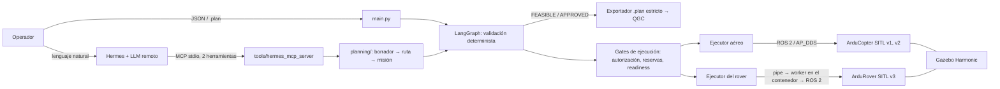

# Demo del TFG para Toni — 04/11/2026

Guion de **10–15 minutos**, con una alternativa de **5–10 minutos** sin Gazebo ni LLM en línea (§14). Ejecutable desde VS Code (terminal WSL). El orden operativo previo está en [demo_toni_checklist_2026_11_04.md](demo_toni_checklist_2026_11_04.md).

**Preparado el 03/11/2026 por el sistema multiagente**, con los comandos comprobados ese día contra el código de la rama `feature/rover-sitl-first-motion`. Las salidas «esperadas» son las observadas el 03/11. Si mañana sale otra cosa, se dice tal cual.

## Etiquetas

| Etiqueta | Significado aquí |
| --- | --- |
| **LIVE_VERIFIED** | Comando ejecutado el 03/11 contra el código actual, repetible en directo sin simulador ni LLM en línea |
| **HISTORICAL_VERIFIED** | Ejecución real registrada en una evidencia sellada cuyo manifiesto se comprobó el 03/11. Vale para su fecha, no como estado de hoy |
| **OFFLINE_ONLY** | Probado solo con pruebas y dobles; nunca contra el simulador o el vehículo |
| **NOT_IMPLEMENTED** | No existe código |
| **NOT_EXECUTED** | El código existe o está preparado, pero no se ha ejecutado de verdad |

**Lo que NO se puede afirmar:**
- que haya una misión completa dron-rover;
- que el rover se haya movido;
- que haya percepción (cámara, cartulina);
- que algo haya funcionado con hardware físico.

## Preparación (una vez, antes de empezar)

```bash
cd ~/TFG/Agentic_Drone_Mission_Control
OUT=$(mktemp -d)
```

Todo lo que escribe va a `$OUT`, fuera del repositorio. Las evidencias se abren y se leen, nunca se modifican.

## Mapa de la demo

| # | Apartado | Min | Modo | Etiqueta |
| --- | --- | --- | --- | --- |
| 1 | Arquitectura | 1,5 | Archivo | — |
| 2 | Hermes y el LLM | 1 | Evidencia + comando | HISTORICAL_VERIFIED |
| 3 | Herramientas MCP | 1 | Comando | LIVE_VERIFIED |
| 4 | Validación con LangGraph | 1,5 | Comando | LIVE_VERIFIED |
| 5 | Misión en lenguaje natural | 1 | Evidencia (+ directo opcional) | HISTORICAL_VERIFIED |
| 6 | QGC `.plan`, entrada y salida | 1,5 | Comandos + evidencia | LIVE_VERIFIED + HISTORICAL_VERIFIED |
| 7 | Simulación con drones | 1,5 | Evidencia (+ directo opcional) | HISTORICAL_VERIFIED |
| 8 | Simulación `rover_only` | 1 | Evidencia (+ directo opcional) | HISTORICAL_VERIFIED |
| 9 | Odometría acreditada | 1 | Evidencia | HISTORICAL_VERIFIED |
| 10 | Worker ROS 2 en `PASSIVE` | 1 | Evidencia + pruebas | HISTORICAL_VERIFIED + OFFLINE_ONLY |
| 11 | Primera navegación de 1 m | 1,5 | Pruebas | OFFLINE_ONLY |
| 12 | Próximos pasos | 1 | Comando + texto | NOT_IMPLEMENTED / NOT_EXECUTED |

Total ≈ 14 min. **Para recortar a 10 min:** quita el 5 y el 10 y acorta el 7.

---

## 1. Arquitectura (1,5 min)

- **Abrir:** el diagrama de abajo (vista previa de Markdown en VS Code: `Ctrl+Shift+V`) y [`docs/hermes-planning.md` § Arquitectura y responsabilidades](../docs/hermes-planning.md#arquitectura-y-responsabilidades).
- **Comando:** ninguno.



**Decir:**
- «El LLM no está en el bucle de control. Traduce la intención del operador a llamadas a herramientas con argumentos estructurados.»
- «La validación, la autorización, las reservas y las órdenes las decide código determinista.»
- «La ejecución pasa por gates propios: autorización exacta, reserva del vehículo, readiness actual. Llega a ArduPilot SITL por ROS 2 (AP_DDS), con Gazebo como mundo físico simulado.»

**Limitaciones:**
- no hay enjambre: la coordinación de los dos drones es **secuencial**;
- no hay percepción;
- El rover todavía no se ha movido.

## 2. Hermes y el LLM (1 min) — HISTORICAL_VERIFIED

**Abrir:**
- [`evaluation/observability/agri_planning_h1_nous_2026_10_24/README.md`](../evaluation/observability/agri_planning_h1_nous_2026_10_24/README.md);
- [`deploy/planner/hermes-config.base.yaml`](../deploy/planner/hermes-config.base.yaml): proveedor `nous`, modelo `poolside/laguna-s-2.1:free`.

**Ejecutar** (verifica el manifiesto de H1 y lee su vínculo; sin red ni LLM):

```bash
.venv/bin/python -c "from pathlib import Path; from observability.hermes_capture_run import verify_manifest; verify_manifest(Path('evaluation/observability/agri_planning_h1_nous_2026_10_24')); import json; b=json.load(open('evaluation/observability/agri_planning_h1_nous_2026_10_24/h1_binding.json')); print('H1', b['status'], {v: a['mission_sha256'][:12] for v, a in b['artifacts'].items()}, b['flight_authorization'])"
```

**Esperado:** `H1 BOUND {'drone_01': '321ad647ab9c', 'drone_02': '079e25a30242'} NOT_GRANTED`

**Decir:**
- «Hermes es un agente de Nous Research (`NousResearch/hermes-agent`, commit fijado `d923a5eb`) que usa un LLM remoto y habla con nuestro servidor MCP.»
- «El 24/10 generó y finalizó dos misiones en una invocación de 55,6 s, con solo dos herramientas permitidas, y el código las vinculó por hash al escenario.»
- «El 28/10 se repitió dentro del contenedor `tfg/planner` y salieron misiones idénticas byte a byte» (`planning_container_real_2026_10_28_r2`).

**Limitaciones:**
- Los datos los daba el prompt completo: es **generación y validación de artefactos a partir de una especificación**, no planificación autónoma.
- Con un modelo gratuito y pocos turnos no hay una tasa de fiabilidad. En H3 el modelo afirmó una autorización falsa y la aceptación determinista lo rechazó.

**Dependencia externa (no comprobada hoy):** ejecutar Hermes en directo exige:
- la cuenta de Joel en Nous Portal y un inicio de sesión vigente (la credencial del 28/10 caducaba);
- que el modelo gratuito siga disponible;
- red.

**No se recomienda en directo.** Si se intenta y falla o tarda, se pasa a esta evidencia.

## 3. Herramientas MCP (1 min) — LIVE_VERIFIED

- **Abrir:** [`tools/hermes_mcp_server.py`](../tools/hermes_mcp_server.py), las descripciones de `update_mission_draft` y `finalize_mission_draft`.
- **Ejecutar** (lista las herramientas registradas; no arranca el servidor ni llama a nada):

```bash
.venv/bin/python -c "import asyncio; from tools import hermes_mcp_server as s; t=asyncio.run(s.mcp.list_tools()); print(len(t)); print(', '.join(x.name for x in t))"
```

**Esperado:** `27` y la lista, que empieza por `start_preflight_sequence, get_preflight_sequence, …` e incluye `update_mission_draft`, `finalize_mission_draft`, `validate_mission`, `validate_and_export_qgc`, `check_simulation_ready` y `execute_approved_mission`.

**Decir:**
- «MCP es el contrato entre el agente y el sistema: cada herramienta tiene un esquema y devuelve resultados estructurados. El LLM no ejecuta código propio: pide herramientas.»
- «El servidor tiene 27 herramientas, también operativas, pero en planificación Hermes solo recibe dos (`tools.include` y `--toolsets tfg-mission-control`). El lanzador se niega a arrancar si cambia ese filtro.»

**Limitaciones:** las descripciones de las herramientas guían al modelo, pero no lo obligan. Lo que obliga es la validación posterior.

## 4. Planificación y validación con LangGraph (1,5 min) — LIVE_VERIFIED

**Abrir:** [`graph/waypoint_mission_graph.py`](../graph/waypoint_mission_graph.py). Tres nodos: `evaluate_waypoint_mission`, `waypoint_replanner` y `waypoint_final_report`, con una ruta condicional.

**Ejecutar (a)**, la misión de tres waypoints, válida:

```bash
.venv/bin/python -c "
from inputs.json_loader import load_mission_json
from graph.waypoint_mission_graph import waypoint_mission_graph as g
s = g.invoke({'mission': load_mission_json('missions/examples/simulation_navigation_3waypoint.json')})
print('RESULT', s['mission_status'], s.get('failure_reasons'))" 2>&1 | grep -E 'NODE|ROUTER|RESULT'
```

**Esperado (a):** `[NODE] evaluate_waypoint_mission`, `[ROUTER] Waypoint mission does not require replanning.`, `[NODE] waypoint_final_report`, `RESULT FEASIBLE []`

**Ejecutar (b)**, la misma misión con 45 km/h de viento (copia en `$OUT`):

```bash
.venv/bin/python -c "
import json
from inputs.json_loader import load_mission_json
from graph.waypoint_mission_graph import waypoint_mission_graph as g
m = json.load(open('missions/examples/simulation_navigation_3waypoint.json')); m['environment']['wind_speed_kmh'] = 45.0
json.dump(m, open('$OUT/wind45.json', 'w'))
s = g.invoke({'mission': load_mission_json('$OUT/wind45.json')})
print('RESULT', s['mission_status'], s['failure_reasons'], s['replan_actions'])" 2>&1 | grep -E 'NODE|ROUTER|RESULT'
```

**Esperado (b):**
- `[ROUTER] Waypoint mission requires replanning.` y `[NODE] waypoint_replanner`;
- `RESULT NOT FEASIBLE`, con «Current wind speed exceeds the mission safety limit»;
- la acción «Delay mission execution until wind speed is at or below 30.0 km/h».

**Decir:**
- «LangGraph lo uso donde hay etapas con estado y rutas condicionales: validación de misión, preflight por misión y el flujo del escenario agrícola (8 nodos).»
- «Las comprobaciones (batería, viento, altitud, tramos) son funciones deterministas. El replanificador propone acciones; no cambia la misión solo.»

**Limitaciones:** el modelo de vuelo es simplificado (tiempo por distancia y velocidad, consumo lineal) y no está calibrado con un vehículo físico.

## 5. Misión en lenguaje natural (1 min) — HISTORICAL_VERIFIED, directo opcional

**Abrir:** [`docs/demo-reunion-2026-10-19.md`](../docs/demo-reunion-2026-10-19.md) § Ejemplo 1. Recoge la conversación con Hermes del 18/10 (`hermes_skill_repetition_2026_10_18`, manifiesto comprobado el 03/11):
- el operador dijo «hacia el este» sin fijar qué arista del rectángulo;
- Hermes conservó los 8 m y **preguntó** la orientación, en lugar de inventarla;
- resultado: 40 × 20 m, FEASIBLE / APPROVED y un `.plan` de 4381 bytes.

**Decir:** «La entrada en lenguaje natural va a un borrador versionado. Lo que falta se pregunta y lo ambiguo no se resuelve a favor del modelo. La geometría la genera código, no el LLM.»

**Directo opcional, solo si hay tiempo:** `main.py`, opción 1, con el LLM **local** (Ollama `qwen3:4b`, sin red).
- **Comprobado el 03/11:** funciona y responde en 5–16 s.
- **Calidad hoy:** con una petición completa extrajo solo los campos que fija el analizador determinista (`vehicle_type`, `autopilot`, `objective_type`, `objective_target`, `return_to_home`) y **pidió el resto**, incluidas coordenadas que sí estaban en el texto.
- Si se enseña, se presenta como «no inventa: pide lo que falta», reconociendo que el modelo local de 4B extrae mal. **No** se presenta como el camino principal.

## 6. Entrada y salida de QGC `.plan` (1,5 min) — LIVE_VERIFIED + HISTORICAL_VERIFIED

**Ejecutar (a)**, el exportador estricto: se niega sin la altitud AMSL del home y exporta con ella.

```bash
.venv/bin/python -c "
from pathlib import Path
from inputs.json_loader import load_mission_json
from inputs.qgc_plan_export import refusal_reasons, build_plan, plan_bytes, verify_plan
m = load_mission_json('missions/examples/simulation_navigation_3waypoint.json')
print('SIN AMSL:', refusal_reasons(m))
plan, log = build_plan(m, planned_home_amsl_m=584.0); p = Path('$OUT/demo_3wp.plan'); p.write_bytes(plan_bytes(plan))
print('CON AMSL 584:', len(plan['mission']['items']), 'items;', verify_plan(p, m, planned_home_amsl_m=584.0)['status'])"
```

**Esperado (a):** `SIN AMSL: ['planned home AMSL altitude is required …']` y `CON AMSL 584: 6 items; FILE_MATCHES_EXPECTATIONS`.

**Ejecutar (b)**, la comparación del `.plan` original con el guardado por QGroundControl 5.1.5:

```bash
P=evaluation/observability/hermes_finalized_package_two_drones_2026_10_30/package/plans
Q=evaluation/observability/qgc_import_hermes_two_drones_2026_10_30/qgc_saved
.venv/bin/python -m tools.qgc_plan_compare $P/drone_01.plan $Q/drone_01.qgc_resaved.plan --out $OUT/cmp01
```

**Esperado (b):** `"status": "NO_SEMANTIC_DIFFERENCES"`, 4 PRESENTATION y 0 SEMANTIC_CHANGE.

**Ejecutar (c)**, la entrada: importar el `.plan` guardado por QGC como misión.

```bash
.venv/bin/python -c "
from inputs.qgroundcontrol_adapter import load_qgroundcontrol_plan
from models.qgc_import import QGroundControlImportContext as C
r = load_qgroundcontrol_plan('$Q/drone_01.qgc_resaved.plan', C(battery_percent=100, battery_consumption_percent_per_minute=0.8, wind_speed_kmh=0, wind_direction_from_deg=0, minimum_battery_reserve_percent=20, maximum_wind_speed_kmh=30, maximum_altitude_m=120, vehicle_id='drone_01'))
print('items', r.source_item_count, 'home AMSL', r.planned_home_amsl_m, [w.waypoint_id for w in r.mission.route.waypoints]); print(r.warnings)"
```

**Esperado (c):** `items 4 home AMSL 584.0 ['QGC_WP1', 'QGC_WP2', 'QGC_WP3']`, más dos avisos: el despegue no se modela y el aterrizaje pasa a punto final.

**Abrir, opcional:** `evaluation/observability/qgc_import_hermes_two_drones_2026_10_30/screenshots/`, con las capturas de QGC: 4 ítems, Takeoff, 2 Waypoints y Land.

**Decir:**
- «El `.plan` solo se escribe si todo está definido; nunca se rellena un valor por defecto.»
- «QGC abrió y guardó los dos `.plan` derivados de Hermes sin cambios semánticos.»

**Limitaciones:**
- No se han cargado en un autopiloto ni leído de vuelta (**NOT_EXECUTED**; preparado para el subsistema rover en [`docs/sitl-plan-transfer-handoff.md`](../docs/sitl-plan-transfer-handoff.md)).
- El ejecutor SITL no usa el `.plan`: envía objetivos GUIDED por ROS 2.

## 7. Simulación con drones (1,5 min) — HISTORICAL_VERIFIED

**Abrir y contar, en este orden:**
1. **Tres waypoints, un dron (18/10):** [`simulation/ros2_gazebo/results/simulated_vehicle_v2_2026_10_18/README.md`](../simulation/ros2_gazebo/results/simulated_vehicle_v2_2026_10_18/README.md).
   - drone_02 en `v2`, informe PASSED y 11/11 comprobaciones;
   - WP1–WP3, regreso y aterrizaje con `armed=false`.
   - El ensayo análogo de `v1` lanzado por Hermes con `execute_approved_mission` (16/10) está en `simulation/ros2_gazebo/results/hermes_three_waypoint_test.md`: es un informe sin manifiesto.
2. **Secuencia de dos drones con 4 POI (24/10):** [`simulation/ros2_gazebo/results/agri_demo_h2_2026_10_24/README.md`](../simulation/ros2_gazebo/results/agri_demo_h2_2026_10_24/README.md).
   - secuencia `FINISHED / PASSED`, con drone_01 primero y drone_02 después;
   - errores horizontales ≤ 0,85 m, con tolerancia de 1 m.
3. **Recuperación tras el reinicio (03/11):** [`…/two_drones_recovery_2026_11_03_attempt2/README.md`](../simulation/ros2_gazebo/results/two_drones_recovery_2026_11_03_attempt2/README.md).
   - arranque en 44 s, READY, parada limpia;
   - sin vuelo.

**Directo opcional:** checklist §4 → §5 (`--profile two_drones`) → §6 → §7. Solo si el precheck está `SATISFIED`, y un único intento.

**Ejecutar en vez de lo anterior, sin simulador:**

```bash
.venv/bin/python -m tools.agri_scenario_flow query --out $OUT/query 2>&1 | tail -7
```

**Esperado:** `Escenario: AERIAL_COMPLETED_GROUND_PENDING; completo: no` y las líneas `R1 ·`. Reconstruye la secuencia H2 desde las copias verificadas (23 archivos).

**Decir:** «Dos ArduCopter SITL en el mismo Gazebo, cada uno con su espacio ROS 2 (`/ap/v1`, `/ap/v2`). El coordinador despacha el segundo dron solo si el primero da PASSED.»

**Limitaciones:**
- no vuelan a la vez ni se reparten tareas;
- la velocidad no se comanda;
- «regreso» es navegar al punto de lanzamiento y aterrizar, no el modo RTL.

## 8. Simulación `rover_only` (1 min) — HISTORICAL_VERIFIED

**Abrir:** [`simulation/ros2_gazebo/results/rover_only_dds_validation_2026_11_03/README.md`](../simulation/ros2_gazebo/results/rover_only_dds_validation_2026_11_03/README.md).

**Contar:**
- un ArduRover SITL (instancia 2, sysid 3) en `/ap/v3`;
- el modelo `rover1` en Gazebo;
- arranque en 16 s, READY y `Vehicle is Armable` al primer intento;
- **RTF 0,64**.

**Decir:**
- «Con tres vehículos y LiDAR el factor de tiempo real era 0,017, inutilizable. Creé un perfil ligero solo con el rover y llegué a 0,6.»
- «Encontré y corregí un fallo de puerto DDS (2039 frente a 2019), y el arranque fallido se cerró con un procedimiento protegido.»

**Directo opcional:**
- checklist §4 → §5 (`--profile rover_only`) → §6 (readiness y métricas) → §7;
- unos 2 minutos en total;
- solo con precheck `SATISFIED` y un único intento.

**Limitaciones:** headless, así que no se ve la ventana de Gazebo. RTF 0,6 significa que el tiempo simulado avanza más despacio que el real.

## 9. Odometría acreditada (1 min) — HISTORICAL_VERIFIED

**Abrir:** [`simulation/ros2_gazebo/results/rover_only_binding_final_2026_11_03/README.md`](../simulation/ros2_gazebo/results/rover_only_binding_final_2026_11_03/README.md) y su `motion-binding.json`.

**Contar:** `MotionBinding` **ACCREDITED_FOR_SESSION**. La odometría del rover queda ligada a:
- un único publicador (`ros_gz_bridge`) con su GID;
- el lifecycle, la ejecución del contenedor y el arranque del host;
- 5 muestras con sellos crecientes;
- la pose de Gazebo, con error 0 m y 0 rad.

**Decir:**
- «Antes de mover nada hay que demostrar *de quién* es la odometría y *en qué marco* está. Si cambia la sesión, el contenedor o el publicador, la acreditación deja de valer.»
- «Hubo que corregir dos defectos que solo salieron en vivo: esperar a todos los publicadores y esperar a que los nombres de nodo estén resueltos.»

**Limitación:** la atribución es al único publicador del grafo, no mensaje a mensaje (límite de `rclpy` en Humble).

## 10. Worker ROS 2 en modo PASSIVE (1 min) — HISTORICAL_VERIFIED + OFFLINE_ONLY

**Abrir:** [`simulation/ros2_gazebo/results/rover_pipe_worker_passive_validation_2026_11_03/README.md`](../simulation/ros2_gazebo/results/rover_pipe_worker_passive_validation_2026_11_03/README.md) y [`tools/rover_pipe_worker.py`](../tools/rover_pipe_worker.py), la cabecera.

**Ejecutar** (pruebas offline del modo pasivo, ~1 s):

```bash
.venv/bin/python -m pytest -q -p no:cacheprovider tests/test_rover_pipe_worker.py -k passive
```

**Esperado:** `20 passed, 73 deselected`.

**Decir:**
- «El host no tiene ROS 2. Un worker dentro del contenedor habla con el host por un pipe privado JSON Lines (`docker exec -i`).»
- «En PASSIVE no crea ni publicador de velocidad ni clientes de servicio: es imposible que mande una orden.»
- «Se validó en vivo: probe y tres observaciones reales, con `cmd_vel` a 0 publicadores durante toda la sesión.»

**Limitación:** el modo OPERATIONAL (con órdenes) solo está probado offline.

## 11. Primera navegación de 1 m preparada offline (1,5 min) — OFFLINE_ONLY

**Abrir:** [`docs/rover-first-navigation-sitl.md`](../docs/rover-first-navigation-sitl.md) §1–§2, con la secuencia GUIDED → ARM → 1 m → HOLD → desarmado.

**Ejecutar** (~7 s):

```bash
.venv/bin/python -m pytest -q -p no:cacheprovider tests/test_rover_first_navigation.py tests/test_rover_first_navigation_timing.py
```

**Esperado:** `35 passed, 3 xfailed`.

**Decir:**
- «Es el ejecutor real, la sesión real y el worker real, pero el rover es un doble cinemático.»
- «Se prueban el recorrido completo y los fallos: GUIDED o ARM rechazados, respuesta perdida, worker muerto, publicador cambiado, sin progreso, autorización reutilizada.»
- «Los 3 *xfail* son defectos conocidos y reproducidos a propósito, pendientes de corrección con el subsistema rover. El más importante: si el estado se retrasa más que el plazo de una llamada, la sesión se rompe antes de poder mandar HOLD. La corrección propuesta está probada en la propia prueba.»

**Limitaciones:**
- **El rover no se ha movido.** Las políticas siguen desactivadas.
- Falta una sesión nueva, una revisión en seco en el mismo lifecycle y una autorización exacta de Joel.
- Lo que solo puede verificar el SITL real está en §4 del documento.

## 12. Próximos pasos (1 min)

**Ejecutar**, si no se hizo en el 7: `.venv/bin/python -m tools.agri_scenario_flow query --out $OUT/q2 2>&1 | grep 'R1 ·'`

**Esperado:**
- `R1 · dependencia: MET · elegibilidad (vista histórica): BLOCKED_PENDING · elegibilidad (esta preparación): NOT_ELIGIBLE [...]`;
- `R1 · autorización: ABSENT · … · ejecución: NOT_STARTED`.

**Decir:**
1. **Primer movimiento SITL de 1 m:** revisión del subsistema rover, una sesión nueva, la revisión en seco y un único ensayo autorizado (**NOT_EXECUTED**).
2. **Coordinación dron-rover:** el dron termina su misión → dependencia MET → el rover va a una coordenada declarada. El coordinador terrestre existe y está probado offline (**OFFLINE_ONLY**); la misión conjunta real es **NOT_EXECUTED**.
3. **Detección de cartulina:** cámara en el dron, detección del color y conversión a una coordenada en el marco del rover (**NOT_IMPLEMENTED**). Primero, coordenada declarada; después, detectada.
4. **Vehículos físicos:** fuera del alcance actual. Ver §15.

---

## 13. Guion hablado con tiempos

| Tiempo | Qué | Frase guía |
| --- | --- | --- |
| 0:00–0:30 | Objetivo | «Un sistema de control de misiones en el que un agente LLM ayuda a planificar, pero todo lo que decide la seguridad es código determinista y verificable.» |
| 0:30–2:00 | §1 | La arquitectura y quién decide qué |
| 2:00–3:00 | §2 | Hermes real, H1, y sus límites |
| 3:00–4:00 | §3 | 27 herramientas, 2 ofrecidas |
| 4:00–5:30 | §4 | FEASIBLE frente a NOT FEASIBLE con replanificación |
| 5:30–6:30 | §5 | Pregunta lo que falta y no inventa |
| 6:30–8:00 | §6 | Exportación estricta, QGC sin cambios semánticos |
| 8:00–9:30 | §7 | Tres waypoints, dos drones en secuencia |
| 9:30–10:30 | §8 + §9 | Rover rápido y odometría acreditada |
| 10:30–11:30 | §10 | El worker que no puede mandar órdenes |
| 11:30–13:00 | §11 | Navegación de 1 m offline y los defectos encontrados |
| 13:00–14:00 | §12 | Cartulina y coordinación dron-rover |
| 14:00–15:00 | Preguntas | §15 |

## 14. Demo de respaldo (5–10 min, sin Gazebo ni LLM en línea)

Solo archivos y comandos offline. Todos los manifiestos se comprobaron el 03/11 con `sha256sum -c` o su verificador.

| Qué | Etiqueta | Evidencia o comando | Qué demuestra / qué no |
| --- | --- | --- | --- |
| Hermes y MCP | HISTORICAL_VERIFIED | `agri_planning_h1_nous_2026_10_24` (comando de §2); `planning_container_real_2026_10_28_r2` | Dos misiones generadas con 2 herramientas y validadas. No es planificación autónoma |
| Lista de herramientas MCP | LIVE_VERIFIED | Comando de §3 | 27 registradas; 2 en planificación |
| Validación LangGraph | LIVE_VERIFIED | Comandos de §4 | FEASIBLE / NOT FEASIBLE con replanificación |
| Misiones QGC | LIVE_VERIFIED + HISTORICAL_VERIFIED | Comandos de §6; `qgc_import_hermes_two_drones_2026_10_30` | Exportación estricta e importación en QGC. Sin carga en vehículo |
| Vuelo de tres waypoints | HISTORICAL_VERIFIED | `simulated_vehicle_v2_2026_10_18` (8 copias verificadas) | PASSED en SITL; sin velocidad comandada ni hardware |
| Dos drones en Gazebo | HISTORICAL_VERIFIED | `agri_demo_h2_2026_10_24` (secuencia PASSED); `two_drones_recovery_2026_11_03_attempt2` (infraestructura) | Secuencial, no simultáneo |
| `rover_only` READY | HISTORICAL_VERIFIED | `rover_only_dds_validation_2026_11_03` | Arranque, READY y Armable; sin movimiento |
| RTF ≈ 0,6 | HISTORICAL_VERIFIED | `rover_only_dds_validation_2026_11_03` (0,639); `rover_only_binding_final_2026_11_03` (0,606) | Medido en ventanas de 20 s |
| `MotionBinding ACCREDITED_FOR_SESSION` | HISTORICAL_VERIFIED | `rover_only_binding_final_2026_11_03` | Odometría ligada a la sesión; caduca con ella |
| Worker PASSIVE con ROS 2 | HISTORICAL_VERIFIED | `rover_pipe_worker_passive_validation_2026_11_03` | Observación sin órdenes |
| Navegación de 1 m | OFFLINE_ONLY | Comando de §11; `rover_first_navigation_offline_2026_11_03` y `…_timing_offline_2026_11_03` | Lógica del host con un doble. **Sin movimiento** |
| Movimiento real del rover | NOT_EXECUTED | — | — |
| Misión conjunta dron-rover | NOT_EXECUTED | `agri_scenario_flow query` → R1 `NOT_STARTED` | — |
| Detección de cartulina | NOT_IMPLEMENTED | — | — |

**Orden de respaldo (≈ 8 min):**
1. §1, diagrama (1 min).
2. §2, comando (1 min).
3. §3, comando (30 s).
4. §4 (a) y (b) (1,5 min).
5. §6 (a) y (b) (1,5 min).
6. §7 con `agri_scenario_flow query` (1 min).
7. Los README de §8–§10 (1 min).
8. §11, pruebas (1 min).

**Si falla un comando,** se abre la evidencia de su fila y se dice en voz alta que es un resultado guardado, con su fecha.

## 15. Respuestas breves

**¿Qué hace Hermes?**
- Es el agente conversacional.
- Recibe la petición del operador, decide qué herramienta MCP llamar y con qué argumentos, y redacta la respuesta.
- En planificación solo puede guardar y finalizar borradores; no ve las herramientas operativas.

**¿Qué hace LangGraph?**
- Orquesta etapas con estado y rutas condicionales: validación → replanificación → informe; snapshot → validación → readiness → ejecución → análisis; y el flujo de 8 nodos del escenario.
- Cada transición queda registrada y todo camino termina en un informe.

**¿Qué aportan las herramientas MCP?**
- Un contrato tipado entre el LLM y el sistema.
- El modelo no escribe archivos ni código: pide operaciones con esquema, y el servidor valida, persiste con hash y devuelve resultados estructurados.
- Se puede filtrar qué herramientas ve cada caso.

**¿Qué decide el LLM y qué no puede decidir?**
- **Decide:** cómo interpretar el texto, qué herramienta pedir y la redacción.
- **No decide:**
  - si la misión es segura (validación determinista);
  - si se autoriza (declaración exacta del operador);
  - qué vehículo se reserva;
  - cuándo se envía una orden;
  - si un resultado se acepta (comparación con lo registrado).
- Ejemplo: en H3 afirmó una autorización falsa y el sistema lo rechazó.

**¿Qué valida el sistema determinista?**
- **La misión:** batería con reserva, viento, altitud máxima, tramos volables y geometría.
- **La exportación:** sin valores por defecto, y AMSL obligatoria.
- **La ejecución:**
  - hash de la misión y de la petición;
  - autorización exacta;
  - reservas por vehículo;
  - readiness actual;
  - identidad del publicador y del marco;
  - parada observada.

**¿Cómo se conectan ROS 2, ArduPilot y Gazebo?**
- ArduPilot SITL simula el autopiloto y publica y recibe ROS 2 mediante AP_DDS (micro-ROS, agente en UDP 2019): `/ap/vN/status`, `mode_switch`, `arm_motors`, `cmd_vel`…
- Gazebo Harmonic simula la física y los sensores, y está acoplado a SITL.
- `ros_gz_bridge` publica la odometría del modelo.
- Todo corre en un contenedor Docker. El host habla con él por `docker exec` (readiness) o por el worker en pipe (rover).

**¿Cómo se coordinarán dron y rover?**
- **Hoy, secuencial y con dependencia lógica:** el dron cumple su misión, la dependencia pasa a MET y el rover recibe una tarea terrestre hacia un punto en su marco `odom`, con su propia autorización.
- **Después:** el punto vendrá de la detección de la cartulina, transformado al marco del rover con la odometría acreditada.
- No hay comunicación directa entre vehículos.

**¿Cómo se organizó el trabajo?**
- **Líneas de trabajo:**
  - rover: identidad, transporte, lifecycle protegido, recuperación y simulación;
  - planificación y multiagente: integración de Hermes y MCP, observabilidad, escenario agrícola, exportador y comparación QGC, distribución y, en esta rama, el perfil `rover_only`, la odometría acreditada, el worker y la preparación de la navegación.
- **Decisiones del autor:** Joel decidió la arquitectura y los requisitos, autorizó cada operación real y revisó los resultados.
- **ACCIÓN NECESARIA DE JOEL:** precisar con sus palabras su aportación directa al diseño y al código. Este documento no puede afirmarlo.

**¿Qué hemos validado realmente?**
- **En SITL real:**
  - vuelos de un dron con tres waypoints;
  - una secuencia de dos drones;
  - arranques, readiness y paradas de los perfiles;
  - odometría del rover acreditada;
  - observación pasiva por el worker.
- **Con Hermes real:** H1 y su repetición en contenedor.
- **En QGC real:** importación y guardado.
- **Todo lo demás del rover:** offline.

**¿Qué falta para los vehículos físicos?**
- **Todo el eslabón físico:**
  - hardware y su autopiloto real;
  - transporte en red real en lugar de DDS local;
  - calibración y marcos con GPS/RTK;
  - geovallas y parada de emergencia física;
  - validación de cada parámetro en campo.
- **El marco legal:** operación de drones y seguro.
- **Y antes, en SITL:** el primer movimiento del rover y la misión conjunta.
- Las pruebas y el SITL no equivalen a fiabilidad física.
