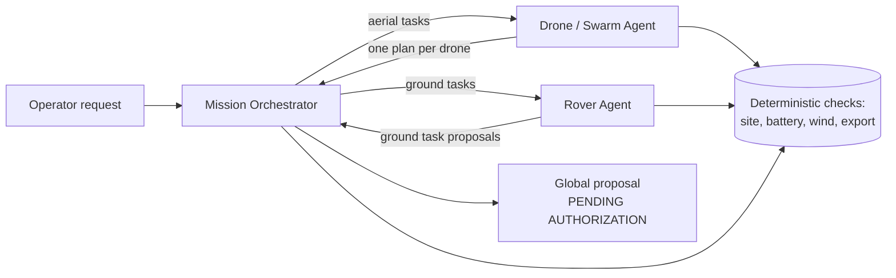

# Agentic Drone Mission Control: from one agent to a team of three

*Short technical overview, November 2026. Scope: mission interpretation, planning, multi-agent design and model
evaluation. Simulation, vehicle control and execution are covered in the full thesis, not here.*

## 1. How it started

The project began at the end of September 2026 as a small question: can a language model turn an operator's
sentence ("fly 3 km north at 40 km/h, wind 20 km/h from the west") into a mission we can check?

The first version combined two pieces:
- a local model (Qwen3 4B through Ollama) that extracted parameters into a strict schema;
- deterministic Python that judged them: flight time with wind, battery reserve and limits.

A LangGraph workflow chained *parse → validate → report*, and could ask again for missing data. One rule was
there from day one: **the model proposes, the deterministic code decides**.

## 2. Towards Hermes, MCP and LangGraph

The single extractor grew into a conversational planner. In mid-October we connected **Hermes**, an open agent
runtime, to the project through an **MCP server**, a standard way to expose tools to an agent.

How the work is split:
- **Hermes** holds the conversation and chooses the tools.
- **The MCP tools** do the real work: they create and update a mission draft, generate relative routes, finalise
  the mission, validate it and export it.
- **Each draft** is versioned and stored with its provenance, so we always know whether a value came from the
  operator or from a tool.
- **LangGraph** still orders the larger flows: the agricultural scenario goes from drones, to the evidence, to a
  ground task, to the report.

Every run can be captured as structured evidence.

## 3. How a natural-language mission is interpreted

1. The operator writes the request. The model's only job is to extract the facts the operator gave: points,
   speeds, altitude, battery and wind.
2. A strict schema rejects anything else: unknown fields, values out of range, non-finite numbers.
3. The **site** is the authority for *where* things are. An objective must name a point declared in the site
   description, and a raw coordinate is accepted only if it matches one of those points. Nothing is invented.
4. Missing or contradictory data comes back as a question, never as a guess.

## 4. How flight plans are generated

A validated mission becomes a QGroundControl `.plan` file through a strict exporter:
- **Commands:** takeoff, speed changes, waypoints and land at the planned home, all at a declared altitude.
- **Checks:** the exporter refuses anything it cannot express faithfully. A separate verifier re-reads the file
  and checks every item against the mission.
- **QGroundControl 5.1.5** opened and saved plans derived from Hermes missions with no semantic differences.

A `.plan` is a candidate for review, never a permission to fly.

## 5. Local models we can test

The development laptop has an RTX 3070 with 8 GB of VRAM.
- **Installed and tested:** Qwen3 4B (about 2.5 GB at 4-bit).
- **Candidates in the 7–8B range at 4-bit:** Qwen3 8B, Llama 3.1 8B and Mistral 7B, plus a small model such as
  Phi-4-mini as a fast baseline.

Ollama is just one way to serve them; the architecture does not depend on it. None of these larger models has
been downloaded or measured yet.

## 6. What AIDA HPC offers: Qwen and Clef

The AIDA HPC service (`aida-hpc.widening.eu`) gives us two different things:
- **Qwen** (`POST /v1/chat/completions`, model `qwen`): a general chat model on remote hardware (exact size
  and version to be confirmed). It lets us compare it with the local Qwen on the same cases.
- **Clef** (`POST /v1/systemone`, model `clef`): this is not a chat model. It returns structured decisions with
  probabilities. We plan to use it as a classifier, for example "is this request feasible, incomplete or
  unsafe?". Probabilities let us measure calibration, not only accuracy.

We have not connected yet: VPN, connectivity and credentials are still pending. The request and response
formats are assumptions until we check them against AIDA's documentation.

## 7. The three-agent architecture

| Agent | Responsibility | Never does |
| --- | --- | --- |
| **Mission Orchestrator** | Understands the request; splits it into aerial and ground tasks; collects the proposals; checks dependencies and coordination; returns one global proposal | Authorize movement |
| **Drone / Swarm Agent** | Distributes aerial objectives among several drones by sensor, battery, wind limit and site rules; builds one validated plan per drone; reports incompatible objectives with reasons | Upload or fly |
| **Rover Agent** | Checks ground targets, the drivable area and declared availability; proposes ground tasks that wait for a drone when needed | Send robot commands |

Three agents do not mean three different models. Today one interpreter, either a model or a rule-based
baseline, serves the orchestrator, and the specialised agents are deterministic. Any of them can be backed by a
model later.

Two safeguards do not depend on the model:
- the orchestrator screens the raw text for unsafe requests, such as skipping authorization, acting
  immediately, disabling a geofence or entering an exclusion;
- it cross-checks the facts the operator stated, such as battery and wind, against what the model extracted.

## 8. Towards swarm coordination

For now, "swarm" means **allocation at planning time**, not coordination in flight.

The Drone/Swarm Agent has a deterministic reference allocator:
- **Search:** for a handful of objectives it tries every assignment and every visiting order.
- **Checks:** each candidate route must pass the site rules, and each mission the battery and wind checks.
- **Choice:** it maximises coverage, then minimises the longest individual flight, then the total distance.
- **Evidence:** it records why each drone could or could not take each objective.

Example (synthetic orchard):
- **Fleet:** an RGB drone and a multispectral drone with less battery and a lower wind limit.
- **Request:** four points to inspect, then a rover visit to one of them.
- **Allocation:** two plans, one per drone.
- **Rover:** its task waits until the multispectral drone has reached that point.
- **Rejection:** a fifth point behind a tree row is rejected for both drones, with the exact reason.

A model can also propose an allocation. It is scored with the same checks as the reference: valid or not, same
coverage, and a ratio of flight times. It is used only if it is valid.

### Separation in time and space

Two individual plans are not a swarm until their separation has been checked. Each plan gets a timeline:
- every leg takes the time our route analysis gives for it, including wind;
- climb and landing take declared durations;
- the declared timing uncertainty grows with flight time.

Two legs conflict when their time windows overlap and they come closer than the declared separation plus both
position uncertainties. The planner then tries, in order:
1. start delays;
2. other ranked allocations;
3. dropping an objective, with the reason stated.

Without declared separation inputs, the proposal stays "coordination pending". The check is conservative and
planning-only: vertical separation and fine dynamics are not modelled.

Example: three drones with two targets 3 m apart and a strict time limit. The best allocation cannot be
separated in time, so the planner drops one target and explains why. With a looser limit, it delays one drone
instead.

We compared synthetic fleets of 1, 2, 3 and 5 drones with different battery, speed, sensors, wind limits and
availability:
- **Coverage:** 4, 6, 7 and 7 of 8 objectives.
- **Conflicts:** every one found was resolved by delays.
- **Search:** a bounded greedy mode takes over beyond six objectives. On smaller cases we compare it with the
  exact search.

## 9. Comparing models with Opik

Each run produces a structured trace. Every step records:
- the agent responsible;
- the model and its version;
- the mission id;
- inputs and outputs, with secrets removed;
- tool calls and validations;
- the measured latency and the outcome.

The same trace converts into Opik's trace and span format. Benchmark metrics travel as metadata, so different
models can be compared on the same cases.

Datasets are split to avoid fooling ourselves:
- **Development:** the original 34 cases.
- **Independent evaluation set:** 33 new cases (adversarial, paraphrases, incomplete, contradictory,
  multi-drone, drone–rover, safety and swarm coordination). It was frozen before any candidate ran on it.

Every case has objective pass criteria. Metrics are kept separate:
- extraction;
- plan validity;
- feasibility;
- safety;
- allocation;
- conflicts;
- latency;
- cost, recorded as unknown when no price is known;
- consistency.

The rule-based baseline shows why the split matters: it passes 94% of the development cases but only 67% of
the evaluation set, and misses two adversarial requests.

Each model is evaluated only on the tasks it is built for:
- **Qwen:** interprets requests and proposes allocations.
- **Clef:** makes structured choices. It classifies requests and picks one of several candidate allocations,
  and is never asked to write a plan.

## 10. What exists and what is pending

**Implemented and tested offline:**
- the three agents and the LangGraph orchestrator;
- the reference swarm allocator, the scoring of model proposals and the time-and-space separation check with
  replanning, on synthetic fleets of 1 to 5 drones;
- development and independent evaluation datasets, comparable result records and a task-by-model matrix;
- the adapters for local Qwen, AIDA Qwen, AIDA Clef and the Hermes provider;
- the benchmark and its metrics;
- the local trace and the Opik payload;
- a reproducible demo, which goes from an agricultural request to two drone plans and one ground task, all
  pending authorization.

All results so far are **synthetic**: synthetic site, declared drone profiles, a rule-based interpreter and test
doubles. No model has been benchmarked yet, and nothing has been sent to Opik with this design.

**Pending:**
- benchmarking local Qwen3 4B, and then larger local models if we agree to download them;
- connecting to AIDA (VPN, credentials, confirming both APIs);
- sending the first real traces to Opik;
- measuring GPU use;
- verified separation inputs (today they are declared values);
- exposing the orchestrator to Hermes as a planning-only tool.
