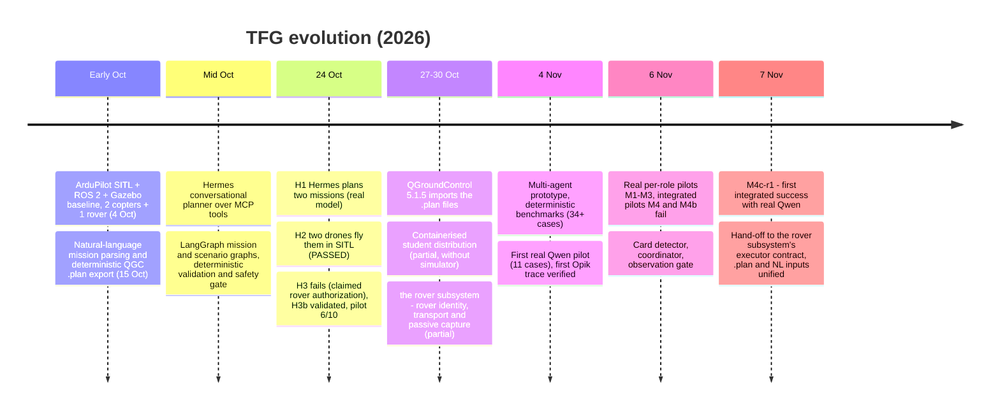
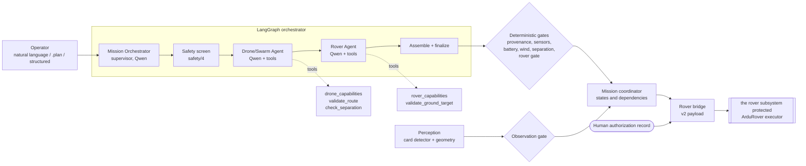
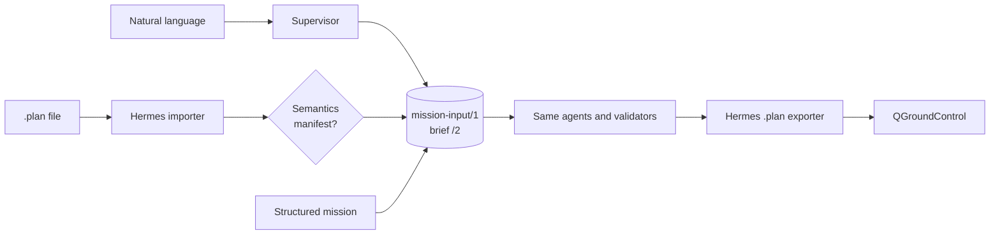
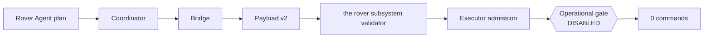
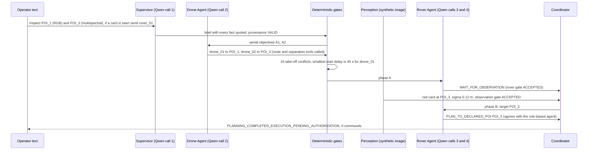

# TFG status report: generative AI for UAV–UGV mission planning (7 November 2026)

**Project:** agentic mission control for agricultural drones and a ground rover.

**Branches described:**
- `feature/multiagent-opik-evaluation`: multi-agent system, evaluation, and this document.
- `feature/rover-sitl-first-motion`: the rover simulation and its protected executor.

**Status labels used throughout:**

| Label | Meaning |
| --- | --- |
| **VERIFIED** | Implemented and covered by automated tests run offline (no vehicle, no simulator) |
| **REAL LLM** | A real model was called in a registered, sealed pilot |
| **SYNTHETIC** | Scripted agents, rendered test images or fixture data. Never presented as a flight |
| **SITL (historical)** | A real run in ArduPilot SITL with Gazebo, valid for its date |
| **NOT INTEGRATED** | Designed or prepared, but not yet connected end to end |
| **PENDING PHYSICAL** | Needs real hardware, which is not connected yet |

---

## Executive summary

The TFG applies generative AI to the creation and interpretation of drone missions, under strict safety rules: **the
models propose, deterministic validators decide, a human authorizes, and only a protected executor could act.**

| Milestone | Status | When |
| --- | --- | --- |
| A conversational planner (**Hermes**, via MCP tools) turned an operator's mission into two validated drone missions | REAL LLM | 24 Oct |
| Those missions were flown in **ArduPilot SITL with Gazebo** with two simulated drones: sequence `PASSED`, every waypoint within 0.85 m | SITL (historical) | 24 Oct |
| Missions export to **QGroundControl `.plan`**, and QGroundControl 5.1.5 imports them without semantic differences | REAL import, no flight | 27–30 Oct |
| A **multi-agent architecture** on a local model (`qwen3:4b`): a supervisor, a Drone Agent and a Rover Agent, built as a LangGraph graph | VERIFIED | — |
| First integrated mission with **real Qwen in all three roles** (**M4c-r1**): a correct plan, no fallback, with 4 real calls | REAL LLM | 7 Nov |
| The rover's plan has been connected, **in software**, to the rover subsystem's protected ArduRover executor contract: it is validated by its real code and stops at the disabled operational gate, with **zero commands** | VERIFIED | 7 Nov |

In M4c-r1, the two drones' routes conflicted during take-off. A deterministic validator, not the model, resolved the
conflict with a **45 s start delay** for one drone. After a synthetic red card was detected, the rover was planned to
go to it, and the mission now waits for human authorization.

**Not done yet:**
- No vehicle, real or simulated, has executed a plan produced by the multi-agent system.
- No rover movement has been measured in SITL. The rover subsystem's protected first-motion trial is still blocked.
- There is no physical hardware in the loop.

---

## 1. Evolution of the project



| Phase | What was built | What it showed |
| --- | --- | --- |
| **1. Simulation baseline** (4 Oct) | ArduPilot SITL, ROS 2 Humble, Gazebo Harmonic and AP_DDS in Docker on WSL2: two ArduCopters and one ArduRover, each in its own ROS 2 namespace (`/ap/v1`, `/ap/v2`, `/ap/v3`) | Pre-arm, GUIDED, arm, take-off, landing and automatic disarm all PASS for both copters, with different target altitudes commanded independently. Rover: pre-arm, mode switch, arm, `cmd_vel` subscription and disarm PASS. Velocity commands were published, but the rover's displacement **was not measured** |
| **2. Mission model and QGC export** (to 15 Oct) | A typed `MissionDefinition`, validation (battery reserve, wind, altitude, site perimeter and exclusions) and a strict QGroundControl `.plan` exporter that refuses anything it cannot represent | Deterministic, reproducible missions |
| **3. Hermes planning** (Oct) | An MCP server with draft, validate, export, preflight and execution-gate tools. Hermes (`hermes-agent`) converses with the operator and calls them. LangGraph graphs run the mission, preflight and scenario flows | H1 to H3b (see §2) |
| **4. SITL rehearsal** (24 Oct) | H2: Hermes' two missions flown in SITL, drone_01 then drone_02, under a protected lifecycle | `FINISHED / PASSED`. The rover task stayed pending |
| **5. Distribution and QGC** (27–30 Oct) | Container images (app, QGroundControl, planner) and a student bundle | QGC import with no semantic differences. The bundle is PARTIAL: the simulator is not included yet |
| **6. Multi-agent system** (4–7 Nov) | Supervisor, Drone Agent, Rover Agent, coordinator, perception, Opik evaluation, and the hand-off to the rover executor | Real Qwen pilots: several failures, then M4c-r1 succeeded |

---

## 2. Generative AI for creating and interpreting missions

Two complementary uses of LLMs, each wrapped in deterministic checks.

**a) Conversational mission creation: Hermes** (REAL LLM, remote model through the Hermes agent)
- Hermes asks for the missing data, then fills a mission draft through MCP tools (`update_mission_draft`,
  `generate_draft_route`, `finalize_mission_draft`, `validate_mission`, `validate_and_export_qgc`).
- The tools only accept facts the operator gave, and reject unknown or non-finite values.
- Validation decides feasibility. A blocked mission may produce a candidate `.plan`, never permission to fly.
- **Results, 24 Oct:**
  - **H1:** two missions built and validated in one invocation (provider `nous`, model `poolside/laguna-s-2.1:free`).
    These were built from a complete specification; they were not autonomous planning.
  - **H3:** **failed**. The model claimed that the rover's movement was authorized.
  - **H3b:** structured output validated.
  - **Query pilot:** 10 attempts. 9 completed, 6 validated, 3 rejected for distinct reasons, and 1 provider timeout.
    This describes one scenario, not a reliability rate.

**b) Multi-agent interpretation and planning on a local model** (REAL LLM: `qwen3:4b` through Ollama, temperature 0)
- The **supervisor** turns free text into a typed *brief*.
  - Every field must quote the operator's words (a provenance contract). A value with no source is not invented: it
    becomes a clarification.
  - A safety policy (`safety/4`) screens unsafe requests.
- **All mission inputs reach the same contract:**
  - natural language (through the supervisor);
  - a QGroundControl `.plan` (through Hermes' importer);
  - a structured mission.
- **What a `.plan` cannot carry**, such as the sensor type, camera actions or a conditional rover task, is reported
  explicitly, or kept in a manifest bound to the file by its SHA-256. It is never lost silently.

---

## 3. Multi-agent architecture



| Component | Role | Who decides |
| --- | --- | --- |
| **Mission Orchestrator** (supervisor) | Interprets the request into a brief; delegates | The LLM proposes; the provenance and safety checks decide |
| **Drone/Swarm Agent** | Assigns the aerial objectives to drones, using route and separation tools | The LLM proposes the assignment; the drone gate checks it against the tools' results |
| **Rover Agent** | Plans the ground task: wait for an observation, or go to a declared point | The LLM proposes; the rover gate decides. The agent can never mark itself as authorized |
| **Mission coordinator** | Tracks the states of the mission, the drones and the rover, and their dependencies | Deterministic |
| **Perception** | Projects a camera detection to a site position and matches it to a declared point | Deterministic, with propagated uncertainty |
| **Rover bridge** | Builds the execution request and the v2 payload for the rover subsystem's executor | Deterministic. Requires a human authorization *record* bound to the exact plan, never a yes/no flag |

**Fallback rule.** When a model proposal fails a gate, a deterministic plan may be used. That fallback is recorded, and
it is never counted as a success of the model.

---

## 4. Two-drone coordination and cooperative behaviour

| Capability | Status |
| --- | --- |
| Allocation of aerial objectives among drones (sensor, availability, wind, battery and route feasibility) | VERIFIED. A deterministic reference allocator, plus the LLM's allocation checked against it |
| Space–time separation between planned routes (conservative, with timing and position uncertainty) | VERIFIED |
| Deconfliction by choosing the **smallest start delay** on a declared 5 s grid | VERIFIED. It gave 45 s in M4c-r1, and its minimality was checked by replay |
| Drone → rover dependencies ("the rover goes after drone_02 reaches POI_3 and drone_01 finishes") | VERIFIED |
| A three-drone tight-separation scenario (conflict → re-planning → rover task) | SYNTHETIC demo |
| Two drones flown in SITL from Hermes' missions | SITL (historical, 24 Oct). Sequential, one after the other |
| Two copters and a rover alive in one simulation, each commanded independently (rover displacement not measured) | SITL (historical, 4 Oct) |
| **In-flight swarm behaviour** (formation, flocking, dynamic re-tasking in flight) | **NOT IMPLEMENTED.** The code says so explicitly: the allocator "is not a swarm controller" |
| Simultaneous SITL execution of a deconflicted multi-drone plan from the multi-agent system | NOT INTEGRATED |

"Cooperation" in this TFG therefore means **planning-time cooperation**: who goes where, when each drone may take off
safely, and when the rover may follow. It is not reactive control during flight.

---

## 5. Hermes, LangGraph and QGroundControl

- **Hermes:** a conversational agent connected to the project's MCP server. It drafts, validates and exports
  missions, runs preflight sequences and reaches the execution gate. Its tests pass in this branch (49).
- **LangGraph:**
  - the mission, waypoint, preflight and agricultural-scenario flows (`graph/`);
  - The multi-agent orchestrator, a `StateGraph`: interpret → screen → decompose → drone agent → rover agent →
    assemble → finalize. 224 graph and scenario tests pass in this branch. 4 further tests are skipped here because
    they need a recorded capture that exists only in the rover subsystem's checkout (they pass where it exists).
- **QGroundControl `.plan`:**
  - **Export:** the strict profile covers take-off, waypoints, speed change and land, and refuses whatever it cannot
    represent.
  - **Import:** Hermes' importer.
  - **Real check:** QGroundControl 5.1.5 opened and saved the files with **no semantic differences** (27 and 30 Oct).
    Nothing was uploaded to a vehicle.
  - **Investigated (7 Nov):** a `.plan` cannot carry the sensor type. MAVLink's camera commands address a camera
    *instance*, so using them would mean inventing a camera id. A hash-bound manifest keeps that information instead.



---

## 6. Simulation: ArduPilot, ROS 2 and Gazebo

| Item | Status | Evidence |
| --- | --- | --- |
| Three-vehicle baseline (2 ArduCopter + 1 ArduRover, ROS 2 namespaces `/ap/v1`, `/ap/v2`, `/ap/v3`) | SITL (historical, 4 Oct) | `validation_3_vehicles.md` (branch `feature/ardupilot-ros2`) |
| H2: Hermes' two missions flown, sequence `6628bc51` `PASSED` | SITL (historical, 24 Oct) | `simulation/ros2_gazebo/results/agri_demo_h2_2026_10_24` |
| Rover: identity, transport, passive telemetry capture (partial), protected lifecycle, STOP contract | The rover subsystem's workstream, according to its reports. **Not independently verified by me** | `evaluation/operations/`, `docs/checkpoints/` |
| Rover first motion in SITL | **BLOCKED.** The operational gate is closed, and today the rover subsystem is resolving a backend and reader-version issue | The rover subsystem's checkpoints of 7 Nov |
| Multi-agent plan → executor | VERIFIED in software only. Nothing reached a simulator | §7 |

H2 accuracy per drone:

| Drone | Take-off height error | Waypoint errors (horizontal) | Return error |
| --- | --- | --- | --- |
| drone_01 | 0.07 m | ≤ 0.21 m | 0.00 m |
| drone_02 | 0.55 m | ≤ 0.39 m | 0.85 m |

Both drones landed and disarmed.

**Software link to the rover executor (7 Nov).** The Rover Agent's plan travels:



- **How the rover subsystem's code is run:** it runs from immutable snapshots of its commits. A working copy is never used.
- **Frame conversion:** site → rover odometry happens **exactly once**. The final owner is the rover subsystem's input adapter; a
  second conversion is refused.
- **The real M4c-r1 plan** is refused for the right reasons: no human speed or time limit, no authorization, and no
  accredited rover position.
- **The synthetic case** passes every check, then stops at the disabled gate.
- **Negative cases:** 29 in total (16 + 13), each blocked with a structured reason.
- **Integration battery:** 18 missions, run on two versions of the rover subsystem's contract. Zero commands.

---

## 7. M4c-r1: the first integrated mission with real Qwen in all three roles

**Setup:**
- **Model:** `qwen3:4b`, Q4_K_M, local, temperature 0, seed 7. Registered beforehand, with at most 6 calls and no
  retries.
- **Scenario:** two aerial zones, POI_1 (RGB) and POI_3 (multispectral). A rover task conditioned on a card being
  seen. The card image is **SYNTHETIC**, and the events are test fixtures.



| Item | Result |
| --- | --- |
| Real calls | **4 of 6**: supervisor 1, Drone Agent 1, Rover Agent 2 (phases A and B) |
| Latency per call | 39.8 s (cold model load), 18.9 s, 11.2 s and 10.3 s |
| Outcome per role | All `MODEL_SUCCESS_FIRST_ROUND`: no revision, no fallback, no parsing error |
| Separation | The model proposed **only** the assignment. The **deterministic** deconfliction chose 45 s, the smallest delay on the 5 s grid that removes all 16 conflicts. A replay shows that every smaller delay leaves conflicts (40 s still leaves 1) |
| Final plan | drone_02 → POI_3 at 0 s; drone_01 → POI_1 at 45 s; rover_01 → POI_3 after drone_02 reaches POI_3 and drone_01 finishes |
| Final state | `PLANNING_COMPLETED_EXECUTION_PENDING_AUTHORIZATION`. No human has set a speed or time limit, so the request is not executable |
| Commands | 0 (nothing was sent to any vehicle or simulator) |
| Verification | Sealed, with SHA-256 checksums. `python -m multiagent.demo --replay <dir>` shows it again **without calling the model** |

**Honest caveats:**
- It is one run at temperature 0, not a statistic.
- The supervisor prompt `/4` was written after the M4b failure.
- Perception was synthetic.

---

## 8. Evaluation with Opik

**Role of Opik.** Opik is the observability and evaluation platform: traces of each agent call and tool span,
feedback scores, and experiment comparisons.
- **Source of truth:** the project's own deterministic evaluation (sealed results with checksums).
- **What Opik adds:** visualisation and comparison.
- **Publishing:** it is always an explicit, separately authorized step.

| Item | Status |
| --- | --- |
| Hermes H1/H3 metadata (October) | Sent and confirmed visually (historical) |
| Multi-agent trace E07 (4 Nov) | **Sent and verified** (HTTP 204, read back with its 12 spans) |
| Re-import of 10 Qwen pilot traces (OP-1, 6 Nov) | **Rejected** by the service (HTTP 400; nothing stored). The likely cause is Opik's 24 h ingestion window for trace ids |
| Corrected re-import (OP-1b) | Prepared, **not authorized, not sent** |
| Phase 2: metrics, feedback scores, experiments, dashboard | Prepared, **not sent** |
| M4, M4b and M4c-r1 traces | Prepared as dry runs only, **not published** |

---

## 9. Tests, quantitative results and evidence

**Automated tests (offline, this branch, 7 Nov):**
- **Multi-agent suite:** 969 tests. 967 pass, 2 are skipped by design (they need a component that exists only in
  the rover subsystem's reviewed contract), 0 fail.
- **Integration smoke run:** 13/13 areas pass. The areas are Hermes, `.plan`, preflight, LangGraph, the three agents,
  perception, coordination, Opik offline, simulator mapping, the rover bridge, and the CLI and replay.

**Real-LLM pilots** (`qwen3:4b`; 41 real calls in total, every pilot registered beforehand and sealed):

| Pilot | Calls | Result |
| --- | --- | --- |
| Interpretation pilot, 11 synthetic cases (4 Nov) | 11 | 5/11 case pass (rule baseline 6/11). Safety correct 9/11 for both |
| M1 supervisor / M2 drone / M3 rover, v1 (6 Nov) | 9 | M1 1/3; M2 1/3; M3 0/3 |
| M2/M3 v2, typed references | 6 | M2 2/3; M3 0/3 |
| M2/M3 v3, bounded multi-turn | 8 of 12 | M2 2/3; **M3 2/3** (one fixed by a second call). Final drone plans always safe |
| M4 integrated | 2 of 6 | Failed. The supervisor marked the conditional rover delegation as unsafe |
| M4b integrated | 1 of 6 | Failed. The supervisor invented three facts; the deterministic checks asked for clarification |
| **M4c-r1 integrated** | **4 of 6** | **Success, first round in all roles** |

Cases are few and hand-picked. 95 % Wilson intervals were reported, and they are wide: none of these is a general
rate.

**Perception (SYNTHETIC images):**
- The card detector (colour thresholds, no learning) gets **35/37** right (v2, 0 false positives).
- An OpenCV port of the same algorithm matches its accuracy (34/37 on v1) and is about 53 times faster (4.4 ms against
  235 ms per image).
- It has not been tested on real photos.

**Deterministic benchmarks (SYNTHETIC):**
- 34+ cases with gold briefs and a rule baseline.
- 17 demo scenarios, all as expected under both safety policies.
- An 18-mission integration battery.

**Main evidence** (all sealed with SHA-256; folder names are relative to `multiagent/benchmark/results/` unless stated):

| Result | Location |
| --- | --- |
| M4c-r1 | `m4c_r1_integrated_v1_2026-11-07_f1ec396c9/` and `docs/milestones/m4c_r1_2026-11-07/MILESTONE.md` |
| Pilots | `pilot_qwen3_4b_v1_2026-11-04_c00b737d3/`, `agents_m1_m3_v1_…`, `agents_m2_m3_v2_…`, `agents_m2_m3_v3_multiturn_…`, `m4_…`, `m4b_…` |
| Executor link | `codex_integration_v2_2026-11-07_0dab97317/` and `codex_adapter_integration_2026-11-07_32c19517d/` |
| Hermes and QGC | `evaluation/observability/agri_planning_h1_nous_2026_10_24`, `agri_scenario_h3b_…`, `qgc_import_hermes_two_drones_2026_10_30` |
| SITL H2 | `simulation/ros2_gazebo/results/agri_demo_h2_2026_10_24` |

---

## 10. Current limitations

- **No multi-agent plan has been executed** by a vehicle or a simulator. No rover movement has been measured in SITL.
- **Real-LLM evidence is small:** one integrated success, and per-role pilots of three cases. The working supervisor
  prompt was written after a failure.
- **A 4B local model** needed tight contracts, typed references and deterministic gates. Tool use is mostly single-turn.
- **Perception is synthetic:**
  - there is no real camera and no measured calibration;
  - the georeferencing uses a flat-ground assumption.
- **Cooperation is planning-time only.** There is no reactive swarm behaviour in flight.
- **There is no authenticated human approval yet.** Authorizations are test records, and they are refused in
  operational mode.
- **Several rover subsystem components are not in a committed version yet:** its reviewed contract patch and its executor input
  adapter. The rover work is reported by its checkpoints; it has not been verified independently.
- **Opik:** only one multi-agent trace is published. The rest is prepared, pending authorization.
- **Physical hardware is not connected:** JetRacer rover, CubePilot drone with Here3+ GNSS.

---

## 11. Next steps towards the full demonstration and the vehicles

1. **The rover subsystem:** commit its executor input adapter and contract patch. Then the rover's plan is converted once, by its
   adapter, and reaches executor admission end to end.
2. **Rover in SITL:**
   - accredited localization and telemetry ingestion;
   - first a joint test without motion;
   - then a first short movement, **only with explicit authorization**.
3. **Two drones in SITL from a multi-agent plan**, using the deconflicted schedule (start delays), and the observation
   from the drone to the rover through the simulator's event stream.
4. **A small registered batch of integrated runs with real Qwen**, to go beyond one case. Publish the traces in Opik
   with authorization.
5. **Real perception:** photos of the cards and camera calibration in the lab.
6. **Physical hardware**, following the lab checklist: read-only telemetry, calibration, an accredited rover position
   source, a STOP test, and only then supervised motion.

---

## 12. Five-minute explanation for the meeting

| Time | Message |
| --- | --- |
| **0:00–0:45 · Goal** | "The TFG uses generative AI to create and interpret drone and rover missions. The rule is: models propose, deterministic validators decide, a human authorizes, and only a protected executor could act." |
| **0:45–1:45 · Evolution** | "First, a simulation baseline with two drones and a rover in ArduPilot and Gazebo. Then a conversational planner, Hermes, over MCP tools, whose missions were flown by two simulated drones in SITL on 24 October and imported into QGroundControl. Now, a multi-agent system on a local model." |
| **1:45–2:45 · Architecture** | Show the diagram in §3: supervisor, Drone Agent and Rover Agent in a LangGraph graph; the tools; the deterministic gates; the coordinator and perception; the bridge to the rover subsystem's executor. |
| **2:45–3:45 · M4c-r1** | Show the sequence in §7: 4 real Qwen calls, all first round. The two drones conflicted at take-off; **the validator, not the model**, delayed drone_01 by 45 s, the proven minimum. The synthetic red card puts the rover's task at POI_3. The result is a plan pending human authorization, with zero commands. Run the replay live, with no model call. |
| **3:45–4:30 · Honesty** | Say what is synthetic (the image, the events), what is historical SITL (H2), and what is not yet done (no vehicle executed a multi-agent plan; no rover movement has been measured; Opik is mostly prepared but unpublished). |
| **4:30–5:00 · Next** | The rover subsystem's executor adapter, then the rover in SITL, then two drones in SITL from a multi-agent plan, then real perception and hardware. |

**Commands for the demo** (offline, no model calls):

```bash
python -m multiagent.demo --replay multiagent/benchmark/results/m4c_r1_integrated_v1_2026-11-07_f1ec396c9
python -m multiagent.demo --scenario red_target --rover-snapshot <dir> --rover-reviewed
python -m multiagent.demo --input-plan multiagent/fixtures/plans/red_target_aerial.plan \
    --plan-manifest multiagent/fixtures/plans/red_target_aerial.plan.semantics.json
```

The step-by-step technical script is in `documentation/demo_technical_script_2026-11-07_en.md`.
